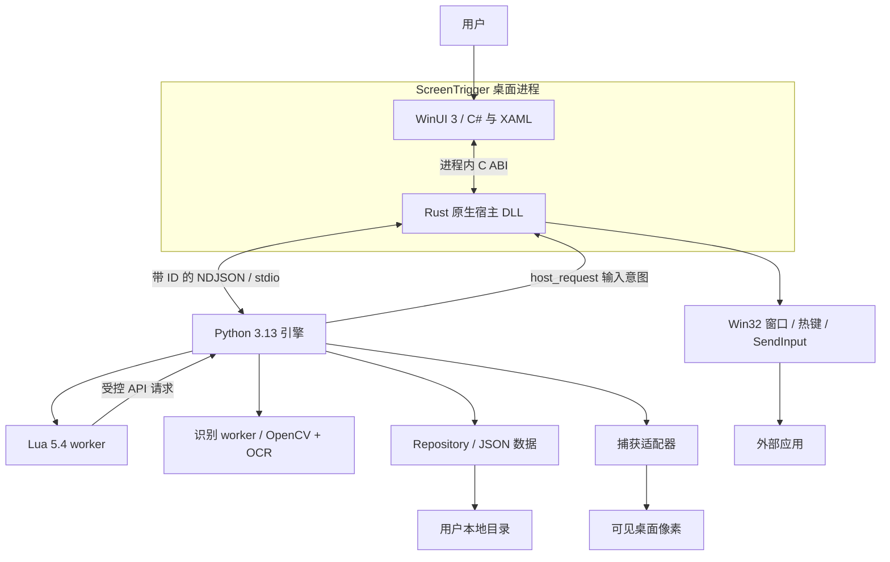

# 架构与系统边界

本文件是技术地图；产品范围见[产品定义](product/产品定义.md)，选型理由见[技术决策](decisions/技术决策.md)。原生架构是迁移目标，现有实现与逐页对照见[全前端 WinUI 3 迁移设计](winui3-migration.md)。

## 进程与外部边界



WinUI 3 管理主窗口、覆盖层和对话框。Rust DLL 与 C# 同进程，负责受控宿主服务并管理后台 Python 进程树。Lua/识别 worker 的进程分离用于可终止性与资源释放，不是敌对代码沙箱。Python worker 不能绕过 Rust 输入服务直接操纵键鼠。识别只返回数据，不执行动作。

系统内部：目标/脚本管理、调度、OCR/图像处理、用户配置、调试与历史。外部：Windows 桌面、应用窗口及其自身响应、模型文件和安装环境。系统无法保证外部应用接受 SendInput，也不保证截图覆盖受保护内容。首版不连接远程服务。

## 8 个业务模块与共享基础设施

1. Capture：显示器/区域捕获，ImageRef 与物理坐标版本。
2. Vision：纯识别及条件树评估，不调用 Input。
3. Target：目标、分组及 Repository；不直接驱动识别和输入。
4. Script：运行调度、Lua VM、同步子调用、临时监控会话。
5. Input：Rust 输入闸门、动作串行、按键持有账本。
6. Window：Rust 窗口身份、客户区几何与前台状态。
7. Debug：宿主调试钩子、暂停快照；通过 Script 的控制端口驱动。
8. IPC：协议校验、命令派发、事件与关联；无业务规则。

共享基础设施包括 Config、Repository、ImageStore、日志、取消令牌和 Host 进程管理，属于横切服务，不为凑“八模块”塞进错误依赖。

允许依赖：UI→IPC；Script→Capture/Vision/Target/Input/Window；Capture→Window 几何快照；Input→Window 状态；Debug→Script 控制接口；业务模块→Repository/日志。禁止 Vision→Input、Repository→UI、Target→Script 执行器。模块通过类型定义交互，不互相访问实例私有状态。

## 所有权与生命周期

| 资源 | 唯一所有者 | 生命周期 |
|---|---|---|
| 应用窗口、弹窗、导航和界面焦点 | WinUI 3 UI 线程 | 主窗随应用生灭，覆盖层限于一次框选会话 |
| Python 进程树、停止热键、输入闸门 | Rust Host | 应用启动至退出 |
| 数据目录写锁和当前 generation | Python Repository | 引擎会话；同目录拒绝第二写者 |
| 根 execution_id、任务状态、取消令牌 | Python Script controller | 每活动根执行独立（≤3），子调用共享父根 |
| Region/窗口绑定/监控会话 | 当前运行草稿及根执行快照 | 仅内存，退出/停止后清除执行副本 |
| 键鼠持有账本与输入租约 | Rust Input | 每活动根执行一个租约（≤3）；子调用继承父根租约 |
| OCR 模型与推理任务 | Vision worker | 模型就绪至关闭/重启 |
| Lua VM、变量、调用栈 | Script worker | 每次根迭代/子调用独立环境 |

启动先读取数据、验证协议/能力、注册停止入口，再允许输入型运行。OCR 失败时纯脚本仍可用，识图功能显示 unavailable。引擎崩溃后关闭闸门、释放本程序按下的输入；自动恢复服务不自动恢复任务。

最多 3 个活动根执行（用户 2026-10-09 确认）。同步子调用共享父根租约，不争抢第二租约。UI 可同时做只读查询；与运行争抢捕获的手动框选先暂停。输入派发前和长动作每个采样点都验证 stop、窗口身份、几何版本及区域；Rust 闸门对多根的 OS 派发仍串行执行。

## 坐标和数据流

XAML 的局部 DIP 坐标只在显示层存在；跨 IPC、图像识别结果和输入统一物理像素。Region 显式带 space；识别 Match 的 bbox 为顶层输入空间，center 为建议点击点。屏幕帧用 screen_physical，导入图用 image_pixel；后者不能直接发鼠标动作。窗口 ROI 为 window_client_physical，捕获时转换为 screen_physical 并带 geometry_revision，动作前复核。

目标打标流：导入/框选 → ImageStore → Target draft → 条件测试 → Repository 提交 → 返回稳定编号。运行流：RunConfig → 不可变目标/脚本快照 → 捕获帧 → Vision → RecognitionResult → Lua/API → Rust 校验输入 → 事件/历史。

## 扩展接口与插件边界

首版只有随应用构建的内置 Provider；没有用户 plugins 目录扫描、pip 自动安装、Lua require 第三方包或动态插件 UI。

```python
class RecognitionProvider(Protocol):
    def capabilities(self) -> ProviderManifest: ...
    def initialize(self, model_dir: Path) -> None: ...
    def recognize(self, frame: Frame, params: dict, cancel: CancelToken) -> ProviderResult: ...
    def close(self) -> None: ...
```

ProviderManifest 必须含 `provider_id, api_version, provider_version, supported_condition_types, model_ids, supported_languages, thread_safe, offline`；api_version 首版为 1，未知 major 拒绝初始化。模型 manifest 含许可证、来源、sha256、字符集/语言覆盖与包版本。识别结果转换为统一的 Match/TextBlock，不把供应商私有对象跨模块传递。

新增 Provider：实现接口 → contract tests → 注册内置工厂 → 添加能力和模型清单 → 更新测试。Provider 不获得 Input、UI 或 Repository 写权限；模型读取由宿主配置目录授予。SQLite 扩展采用同样的 Repository 接口，不泄漏 SQL 到 UI。真正的外部插件加载、隔离、签名、升级和分发协议留到后续决策，不假装首版已有插件系统。
