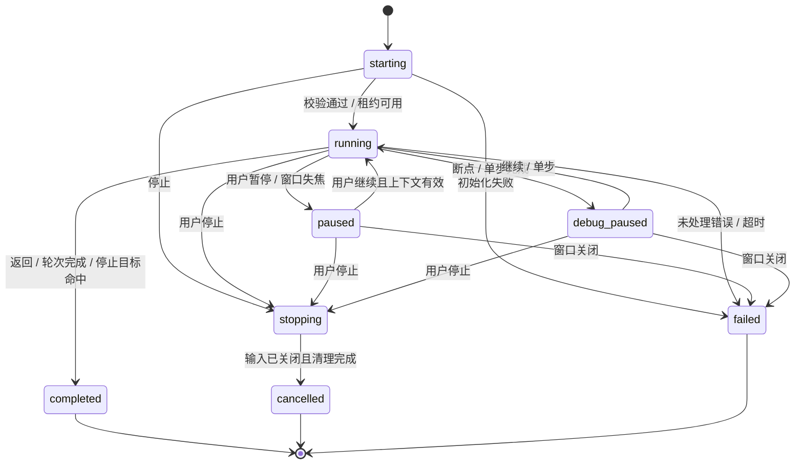
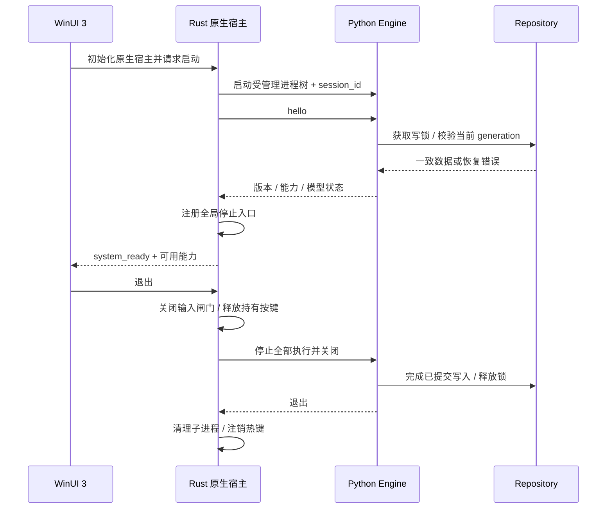
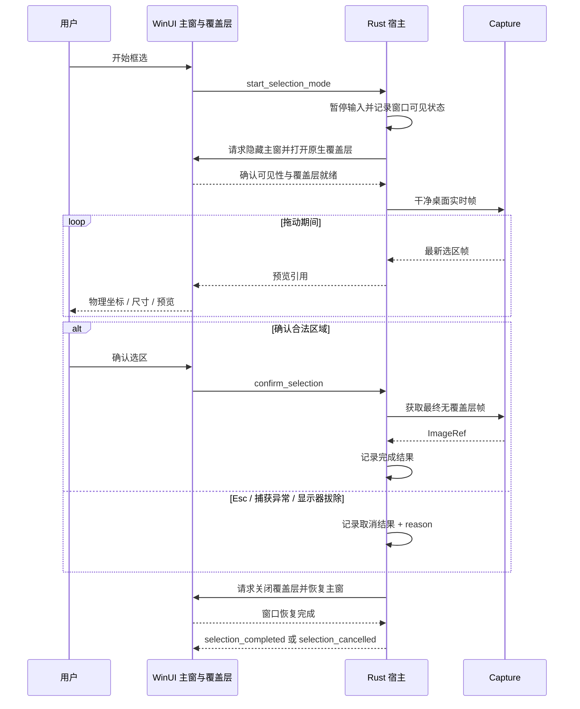
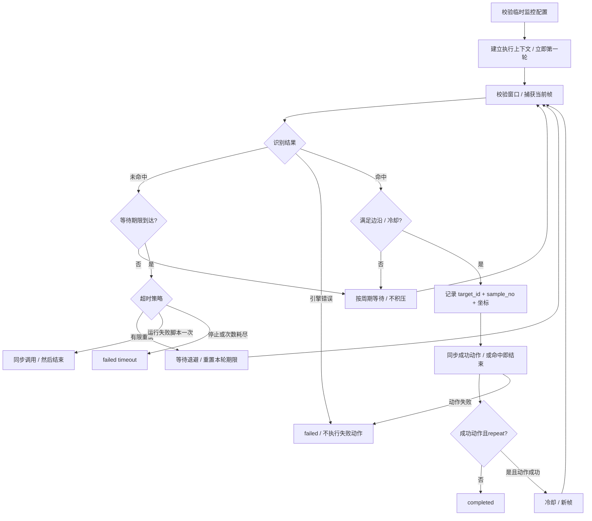
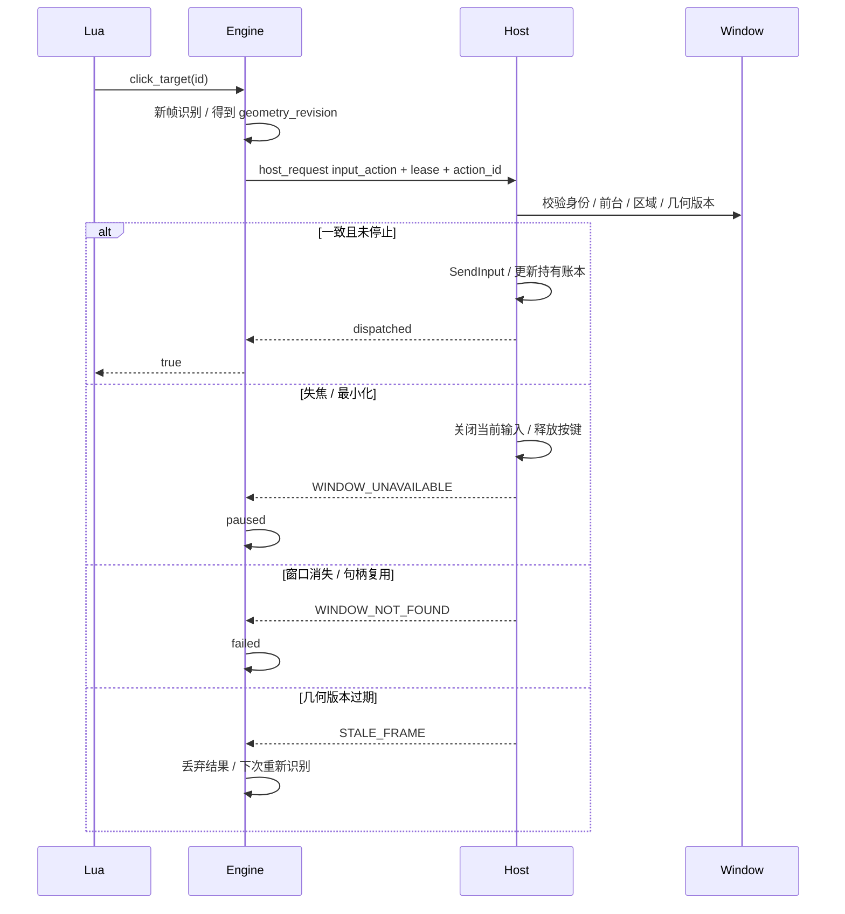

# 状态机与关键时序

此处为产品 F01–F08 的实现视图；状态字符串以 02 为准。任何实现都必须覆盖失败和取消分支，不能只照成功线写代码。

## 根执行状态

完成/失败/取消都先执行输入清理再发布终态。输入闸门的关闭早于耗时资源清理。until_target 命中终态 completed(reason=target_detected)；手动/脚本 stop 终态 cancelled；等待策略 stop 到期为 failed(reason=timeout)。若停止与成功同时到达，由 controller 的单一事件队列决定先接受者，已进入 stopping 不再接受完成结果，终态只发一次。

paused/debug_paused 不继续计根执行期限。恢复时重新验证窗口/区域；未满足仍保持暂停。只有 debug_paused 支持单步，普通暂停可继续或停止。stopping 拒绝 pause/resume/新输入，重复 stop 返回相同状态。

## 启动与退出

协议不匹配则拒绝运行；OCR 缺模型仅影响 OCR。启动 30s 超时展示重试/诊断，不能显示“已就绪”。引擎异常退出也执行 Host 清理；应用退出最多等待 2s 工作任务清理，超时终止 worker，未提交数据保持旧 generation。

## 框选

事件发送须在恢复动作完成之后。重复会话 BUSY；临时帧释放；之前运行的脚本保持暂停。

## 监控到动作

所有等待/识别/动作都有 stop 旁路：关闭输入闸门 → 取消 token → 释放持有输入 → 丢弃迟到帧 → cancelled。不要把取消画成“进入超时失败脚本”的路径。

## 输入与窗口变化

UI 不收到 target_detected 就自行点击；只有执行器调用输入。已派发到 OS 的事件无法撤回，但停止后不会派发新事件。STALE_FRAME 不是允许无限重试整个脚本的理由。

## 保存与调试

保存：验证字段/外键 → 获取 Repository 锁 → 比对 revision → 写新资产和 generation → fsync/校验 → 原子 current 切换 → 更新内存 → 返回成功/发送 catalog_changed。失败在切换前保留旧指针；切换后查询新 revision 判断已提交。

调试：启动固定源码 hash → 宿主安装 line/count/call/return hooks → Lua 行前命中断点 → 释放输入并暂停 → 获取只读栈/变量 → 用户 step/continue → 校验窗口 → 下一行/调用深度处再次暂停。调试 hook 属于宿主私有状态，不能通过给脚本重新开放 debug 库实现。
